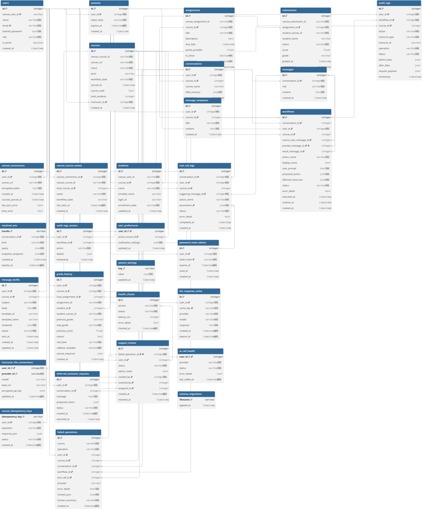

# System Design

## Introduction

This document presents the system design for the Canvas Workflow Assistant, a secure AI-powered platform designed to assist instructors in managing selected Canvas Learning Management System (LMS) workflows through natural language interactions and workflow automation.

The primary goal of the system is to reduce the administrative workload associated with course management while maintaining transparency, security, and human oversight. By integrating with Canvas and leveraging locally hosted large language models (LLMs), the platform enables users to perform tasks such as analyzing missing submissions, generating student communications, creating assignments, and reviewing course analytics through a conversational interface.

The system supports two primary user roles: Instructors and System Administrators (`users.role` is `instructor` | `admin`). Each role is provided with a dedicated interface and permissions appropriate to their responsibilities. To ensure accountability and user control, all AI-generated actions are presented through a workflow preview and approval process before execution.

This document describes the overall architecture, use case models, database design, data flow diagrams, and user interface design of the system. Together, these components provide a comprehensive overview of how the Canvas Workflow Assistant is structured and how users interact with the platform.

## System Architecture Design

Old:

New:

## Architecture Pattern

This system uses a **Strict Layered Architecture** combined with a
**Microservices decomposition** within the backend tier.

The layered pattern enforces that each zone only communicates with the
zone directly below it which means that the React frontend is isolated from PostgreSQL,
and FastAPI never influences Ollama. This satisfies the core non-functional
requirements around LLM isolation and credential security at the
infrastructure and for the purposes of this project.

The microservices pattern applies within the backend: FastAPI, optional MCP
Server, LLM providers (e.g. Ollama), and PostgreSQL are independently
deployable subsystems, each with a single responsibility. This allows the
team to develop, test, and replace each subsystem without coupling.

Two explicit design decisions drove the architecture:

1. **Canvas credentials stay off the LLM path.** Instructor Canvas tokens
   are stored **encrypted** on the FastAPI host (`canvas_connections`) and are
   never sent to the LLM. An optional **MCP sidecar** (`MCP_ENABLED`, default
   `false`) can act as an additional Canvas tool gateway with host allowlisting;
   it is not the sole credential store. Direct Canvas HTTP from FastAPI remains
   the default path for many workflows.

2. **Pydantic as both the PII sanitiser and output validator.** Rather than
   a separate processing module, Pydantic field validators handle personal identifiable information field
   replacement on Canvas input, and schema
   validation on LLM output. This reduces the component count and makes
   the transformation and validation a single auditable step.

---

## Component Rationale

### Frontend — React, TypeScript, Tailwind CSS, shadcn/ui

A browser hosted frontend is a **module**, not a
subsystem because it cannot operate independently and depends entirely on the
FastAPI layer below it. React handles all user interaction and renders
three views: the chat panel, the dry-run preview, and the audit log viewer.
For example, TypeScript enforces type safety across the UI. shadcn/ui provides accessible, consistent components
without a heavy runtime.

### FastAPI Subsystem — Python 3.12, JWT, bcrypt

FastAPI is the API gateway and orchestration layer. It contains three
modules:

- **Chat / orchestration** — receives prompts from the frontend, runs the
  assistant loop (LLM + tool dispatch), and returns confirmable previews.
- **Authentication module** — verifies JWT tokens and enforces RBAC for
  instructors and administrators before any downstream call is made.
- **Preview / write services** — build dry-run previews and execute confirmed
  Canvas writes (direct Canvas HTTP, or via MCP when enabled).

FastAPI holds **encrypted** Canvas connection records and orchestrates LLM
calls through provider adapters. The LLM never receives raw Canvas tokens.
FastAPI sits between the browser and the trusted server-side subsystems.

### MCP Server Subsystem (optional)

MCP is an optional sidecar that can expose Canvas tools behind a shared
secret and hostname allowlist (`MCP_ALLOWED_CANVAS_HOSTS`). When
`MCP_ENABLED` is false (the default), FastAPI talks to Canvas directly.

When enabled, MCP may:

- Receive authenticated tool calls from the backend
- Attach the instructor Canvas token for allowed hosts
- Execute selected Canvas operations after the instructor has confirmed
  the write in the product UI

LLM provider calls (Ollama / OpenAI-compatible / Anthropic) are orchestrated
from FastAPI / provider adapters — MCP is not required for chat.

### Ollama Subsystem — Llama 3.8B, LoRA

Ollama runs locally on the host machine and it serves the LoRA fine-tuned Llama 3.8B model. LoRA is a
**build-time** fine-tuning technique where the adapted weights are merged into
the model before deployment and are not a runtime step. During inference,
the model simply behaves as if it was trained to output structured Canvas
action JSON. Ollama is isolated from the internet meaning the LLM cannot make outbound calls
even if there was a network access.

### PostgreSQL Subsystem — SQLAlchemy

PostgreSQL is the persistence layer containing four logical tables:

- **users / sessions** — stores credentials and active session tokens.
  Passwords are stored as bcrypt hashes, never plaintext.
- **course cache** — stores timestamped Canvas API responses to avoid
  redundant API calls against Canvas's rate limits. The backend checks this before
  hitting Canvas.
- **Canvas API call log** — records the JSON schema and auth token shape
  of every outbound Canvas call for audit purposes.
- **audit log** — immutable append-only record of every instructor action,
  timestamp, and result. Supports two use cases: transparency (instructors
  can review past actions) and rollback (revert to a previous safe state if
  a partial update fails).

SQLAlchemy sits in front of all four tables, enforcing typed models
and preventing raw SQL construction that could introduce injection risks.

### Canvas LMS REST API — External

Canvas is the primary external LMS subsystem. It is accessed with the
instructor's encrypted Bearer token from FastAPI (and optionally via the MCP
sidecar when enabled). Tokens are instructor-scoped to the courses that
instructor can access, preventing one instructor from modifying another's
courses even if credentials were somehow confused. Tokens are never sent to
the LLM.

## Use Case Models
### Use Case Diagram

---

### Use Case 1: Authenticate User (Login)
* **Primary actor:** Instructor, System Administrator 
* **Description:** User logs into the application securely to receive an active session token. 
* **Precondition:** User account exists in the PostgreSQL database. 
* **Postcondition:** User is granted an active JWT and redirected to their respective dashboard. 

**Main scenario:**
1. User navigates to the login screen at `localhost:3000`.
2. User inputs their email and password and clicks "Login."
3. System verifies the password hash against the database.
4. System generates a JSON Web Token (JWT) for the session.
5. System redirects the user to the Course Dashboard (or System Dashboard for Admins).

**Extensions:**
* **3a. Invalid credentials.**
  * 3a1. System detects a mismatch in the email or password hash.
  * 3a2. System denies entry and displays an error banner: "Invalid email or password."

---

### Use Case 2: Terminate Session (Logout)
* **Primary actor:** Instructor, System Administrator 
* **Description:** User securely exits the application, invalidating their active session. 
* **Precondition:** User is currently authenticated. 
* **Postcondition:** Session is terminated and user is returned to the login screen. 

**Main scenario:**
1. User clicks the "Logout" button in the navigation bar.
2. System immediately invalidates the active JWT.
3. System clears cached user data from the local browser storage.
4. System redirects the user to the Login screen.

---

### Use Case 3: Create User Account
* **Primary actor:** System Administrator 
* **Description:** Admin provisions a new user profile and assigns a role. 
* **Precondition:** Admin is authenticated and viewing the User Management portal. 
* **Postcondition:** A new user record is created in the PostgreSQL database. 

**Main scenario:**
1. Admin clicks "Add New User."
2. Admin enters the new user's email, assigns a temporary password, and selects a role (Instructor or Admin, per product rules).
3. Admin clicks "Save."
4. System hashes the temporary password and creates the user record in the database.

**Extensions:**
* **4a. Email already exists.**
  * 4a1. System database detects a duplicate email address.
  * 4a2. System prevents creation and alerts the Admin: "User with this email already exists."

---

### Use Case 4: Connect Canvas Account
* **Primary actor:** Instructor 
* **Description:** User inputs their Canvas API token so the application can communicate with the Canvas LMS. 
* **Precondition:** User is authenticated. 
* **Postcondition:** The API token is securely encrypted and stored in the database. 

**Main scenario:**
1. User navigates to the Settings dashboard.
2. User pastes their Canvas API token into the input field and clicks "Save."
3. System encrypts the token via AES-256.
4. System saves the encrypted token to the user's database row.
5. System makes a test call to the Canvas API to verify access scopes.
6. System confirms success with a green toast notification.

**Extensions:**
* **5a. Token is invalid or lacks scopes.**
  * 5a1. The Canvas API returns an HTTP 401 (Unauthorized) or 403 (Forbidden) error.
  * 5a2. System deletes the invalid token from the database.
  * 5a3. System displays an error banner: "Authentication Failed: Ensure token is valid."

---

### Use Case 5: View Course & Submission Dashboard
* **Primary actor:** Instructor 
* **Description:** User views a color-coded grid of student submission statuses. 
* **Precondition:** User has a valid API token stored. 
* **Postcondition:** The dashboard renders the current submission data. 

**Main scenario:**
1. User selects a specific course from the sidebar.
2. System queries the PostgreSQL cache for recent course assignments and submissions.
3. System renders the submission status grid (submitted, late, missing, excused).

**Extensions:**
* **2a. Cache is expired (TTL exceeded).**
  * 2a1. System automatically queries the Canvas API for fresh data.
  * 2a2. System updates the PostgreSQL cache before rendering the grid.
* **2b. Canvas API rate limit or timeout.**
  * 2b1. The Canvas API returns an HTTP 429 error or times out during the fetch.
  * 2b2. System initiates an exponential backoff retry.
  * 2b3. If retries fail, system displays a warning and shows the last known cached data.

---

### Use Case 6: Filter & Search Dashboard Data
* **Primary actor:** Instructor 
* **Description:** User dynamically filters the dashboard to locate specific students or assignment statuses. 
* **Precondition:** The Course Dashboard is populated with data. 
* **Postcondition:** The UI updates to show only requested data without querying the backend. 

**Main scenario:**
1. User clicks the "Status" filter toggle and selects "Missing."
2. The frontend system isolates records matching the criteria.
3. System dynamically updates the grid to display only students with missing assignments.

---

### Use Case 7: Draft & Send AI Reminder Messages
* **Primary actor:** Instructor 
* **Description:** User prompts the AI to draft messages, reviews them, and executes the send action. 
* **Precondition:** User is viewing a specific Course Dashboard. 
* **Postcondition:** Messages are dispatched via Canvas API and logged in the database. 

**Main scenario:**
1. User enters a command (e.g., "Draft a reminder to everyone missing Assignment 3").
2. System parses the command via the local LLM.
3. System identifies targeted students and generates a visual Dry-Run Preview of the drafted text.
4. User reviews the draft and clicks "Approve & Execute."
5. System decrypts the user's Canvas token and dispatches the messages via the Canvas API.
6. System logs the executed action in the database.

**Extensions:**
* **2a. LLM fails to parse prompt.**
  * 2a1. Pydantic validation rejects the LLM output. System prompts user to rephrase.
* **4a. User alters the draft.**
  * 4a1. User types in the preview text box to change the message tone before confirming.
* **4b. User aborts the action.**
  * 4b1. User clicks "Cancel"; draft is discarded, no API call is made.

---

### Use Case 8: Create Canvas Assignment via AI
* **Primary actor:** Instructor 
* **Description:** Instructor prompts the AI to create a new assignment in Canvas. 
* **Precondition:** Instructor has "Write" permissions on their Canvas token. 
* **Postcondition:** A new assignment is instantiated in Canvas and logged. 

**Main scenario:**
1. Instructor types a creation command (e.g., "Create a Week 6 Check-in quiz").
2. System parses the command and resolves dates via the LLM.
3. System checks Canvas for duplicate assignment names.
4. System generates a staging card showing proposed assignment fields.
5. Instructor reviews and clicks "Approve & Execute."
6. System creates the assignment via the Canvas API.
7. System logs the creation event in the database.

**Extensions:**
* **3a. Duplicate assignment name detected.**
  * 3a1. System flags the duplicate in the Dry-Run Preview, requiring the instructor to rename it.
* **5a. Instructor tweaks assignment parameters.**
  * 5a1. Instructor modifies fields (e.g., Points Possible) before executing.

---

### Use Case 9: View Personal Action History Log
* **Primary actor:** Instructor 
* **Description:** User reviews their own past automated actions to ensure accountability. 
* **Precondition:** User has previously executed an AI action. 
* **Postcondition:** User successfully views their localized history. 

**Main scenario:**
1. User clicks on the "History" tab in the dashboard.
2. System queries the PostgreSQL database for audit logs strictly matching the current user's ID.
3. System displays a table with timestamps, action types, and affected entities.

---

### Use Case 10: View System Health Dashboard
* **Primary actor:** System Administrator 
* **Description:** Admin views high-level application metrics. 
* **Precondition:** Admin is authenticated. 
* **Postcondition:** Admin views real-time status of the local deployment. 

**Main scenario:**
1. Admin navigates to the System Dashboard.
2. System aggregates data from the database and Docker environment.
3. System displays active sessions, API error rates, and container health.

**Extensions:**
* **2a. Container health metrics unreachable.**
  * 2a1. System fails to read Docker stats.
  * 2a2. System displays standard database metrics but grays out container statistics with a "Data Unavailable" badge.

---

### Use Case 11: Modify User Roles & Permissions
* **Primary actor:** System Administrator 
* **Description:** Admin changes the access level of an existing user. 
* **Precondition:** Admin is viewing the User Management portal. 
* **Postcondition:** The target user's role is permanently updated. 

**Main scenario:**
1. Admin selects a user from the account list.
2. Admin changes the role drop-down (for example from Instructor to Admin where allowed) and clicks Save.
3. System updates the role column in the PostgreSQL database.

**Extensions:**
* **3a. Admin attempts to demote the final Admin account.**
  * 3a1. System detects the action would leave the system without an administrator.
  * 3a2. System blocks the action and displays an error warning.

---

### Use Case 12: Deactivate User Account
* **Primary actor:** System Administrator 
* **Description:** Admin revokes application access for a user. 
* **Precondition:** Target user exists in the database. 
* **Postcondition:** User can no longer log in or execute actions. 

**Main scenario:**
1. Admin clicks "Deactivate" next to a user's profile.
2. System flags the account as `is_active: false` in the database.
3. System immediately invalidates any active JWTs for that user.

---

### Use Case 13: View System-Wide Master Audit Log
* **Primary actor:** System Administrator 
* **Description:** Admin reviews the master ledger of all user actions for compliance. 
* **Precondition:** Admin is authenticated. 
* **Postcondition:** Admin views actions taken across all accounts. 

**Main scenario:**
1. Admin navigates to the Master Audit tab.
2. System queries PostgreSQL for all logged AI events across all users.
3. System displays the ledger sequentially.

**Extensions:**
* **2a. Large dataset retrieval.**
  * 2a1. System detects more than 100 rows of audit logs.
  * 2a2. System implements pagination, loading the first 50 results to maintain UI performance.

---

### Use Case 14: Reset User Password
* **Primary actor:** Instructor, System Administrator 
* **Description:** User recovers access to their account. 
* **Precondition:** User is on the login screen. 
* **Postcondition:** User sets a new password and gains entry. 

**Main scenario:**
1. User clicks "Forgot Password" and enters their email.
2. System validates the email against the database.
3. System prompts the user to enter and confirm a new password.
4. System generates a new password hash and overwrites the old hash in the database.

**Extensions:**
* **2a. Email not found.**
  * 2a1. System does not find the email in the database.
  * 2a2. To prevent account enumeration attacks, system displays a generic "If this email exists, a reset process has started" message, taking no database action.
 
  
## Database Design 

### Previous ER Diagram

The original ER diagram captured the first version of the application schema, focused on users, sessions, courses, assignments, submissions, conversations, messages, workflows, audit logs, and message templates.

---

### Updated ER Diagram

The current database design has expanded to support multi-Canvas connections, cached course and student data, workflow lifecycle tracking, idempotent Canvas writes, LLM configuration, health monitoring, failed-operation troubleshooting, support tickets, and richer audit/history records.

### Entity Descriptions and Relationships

---

#### **users**
- `id`: Primary Key
- `canvas_user_id`: Unique Canvas identifier, nullable for admins
- `name`, `email`, `hashed_password`, `role`, `is_active`, `created_at`

Represents application users. Current roles are `instructor` and `admin`. Each user can have sessions, Canvas connections, courses, conversations, workflows, templates, drafts, preferences, and audit records.

---

#### **canvas_connections**
- `id`: Primary Key
- `user_id`: Foreign Key → `users`
- `canvas_url`, `encrypted_token`, `courses_synced_at`, `last_sync_error`, `time_zone`, `created_at`

Stores encrypted Canvas API connections per user and Canvas instance. The unique pair of `user_id` and `canvas_url` allows one instructor to connect to multiple Canvas hosts while keeping tokens scoped to the correct institution.

---

#### **sessions**
- `id`: Primary Key
- `user_id`: Foreign Key → `users`
- `token_hash`, `expires_at`, `created_at`

Tracks active login sessions for authenticated users. When a user logs in, a session record is created with a hashed token and an expiry timestamp. This is how the system validates whether a user is currently authenticated.

---

#### **courses**
- `id`: Primary Key
- `canvas_course_id`: Canvas course identifier
- `canvas_url`: Canvas instance where the course lives
- `name`, `term`, `workflow_state`, `synced_at`, `course_code`, `total_students`, `instructor_id`, `created_at`

Stores courses imported from Canvas. Courses are unique per `canvas_course_id`, `instructor_id`, and `canvas_url`, which supports co-instructors and multiple Canvas instances with overlapping numeric IDs.

---

#### **canvas_course_names**
- `id`: Primary Key
- `canvas_connection_id`: Foreign Key → `canvas_connections`
- `local_course_id`: Foreign Key → `courses` (optional)
- `canvas_course_id`, `name`, `workflow_state`, `last_seen_at`, `created_at`

Stores observed course-name aliases for chat and LLM course resolution. This helps the assistant resolve courses even after Canvas renames or when the same Canvas course ID exists on different Canvas hosts.

---

#### **assignments**
- `id`: Primary Key
- `canvas_assignment_id`: Canvas assignment identifier
- `course_id`: Foreign Key → `courses`
- `title`, `description`, `due_date`, `points_possible`, `is_active`, `published`, `created_at`

Stores assignments within a course, synced from Canvas or created through approved workflows. Canvas assignment IDs are unique only within a course, so the database enforces uniqueness on `canvas_assignment_id` and `course_id` together.

---

#### **submissions**
- `id`: Primary Key
- `canvas_submission_id`: Canvas submission identifier
- `assignment_id`: Foreign Key → `assignments`
- `student_canvas_id`, `student_name`, `status`, `score`, `grade`, `graded_at`, `submitted_at`

Tracks individual student submissions per assignment. Status supports `missing`, `late`, `submitted`, `graded`, `unsubmitted`, and `excused`. Submission identity is scoped to the assignment because Canvas submission IDs are not globally unique in all environments.

---

#### **students**
- `id`: Primary Key
- `canvas_user_id`: Canvas student identifier
- `course_id`: Foreign Key → `courses`
- `name`, `sortable_name`, `login_id`, `enrollment_state`, `updated_at`

Stores enrolled students per course as cached Canvas data. Students remain separate from `users` because the application is instructor/admin-facing.

---

#### **conversations**
- `id`: Primary Key
- `user_id`: Foreign Key → `users`
- `course_id`: Foreign Key → `courses` (optional)
- `course_name`, `field_memory`, `created_at`

Represents a chat session between a user and the AI assistant. Conversations can be course-scoped and retain field memory so follow-up prompts can reuse confirmed context across turns.

---

#### **messages**
- `id`: Primary Key
- `conversation_id`: Foreign Key → `conversations`
- `role`, `content`, `created_at`

Stores the individual messages within a conversation. Each message is attributed to either the `user` or the `assistant` via the `role` field, forming the full back-and-forth chat history.

---

#### **workflows**
- `id`: Primary Key
- `conversation_id`: Foreign Key → `conversations` (optional)
- `user_id`: Foreign Key → `users`
- `course_id`: Foreign Key → `courses` (optional)
- `source_user_message_id`, `preview_message_id`, `result_message_id`
- `action_name`, `display_name`, `user_prompt`, `proposed_action`, `affected_resources`, `status`, `error_detail`, `executed_at`, `undone_at`, `created_at`

The core of the system's human-in-the-loop safety model. Workflows track proposed Canvas write actions from preview through execution, failure, cancellation, pause/resume, supersession, and undo.

---

#### **tool_call_logs**
- `id`: Primary Key
- `conversation_id`: Foreign Key → `conversations`
- `user_id`: Foreign Key → `users`
- `course_id`: Foreign Key → `courses` (optional)
- `triggering_message_id`: Foreign Key → `messages`
- `action_name`, `parameters`, `status`, `error_detail`, `completed_at`, `created_at`

Tracks Canvas-reading assistant tool calls separately from workflows. Read actions execute immediately, while write actions require workflow preview and confirmation.

---

#### **resolved_sets**
- `handle`: Primary Key
- `conversation_id`: Foreign Key → `conversations`
- `kind`, `query`, `snapshot_recipients`, `created_at`, `expires_at`

Stores server-computed recipient sets for actions like messaging students with missing work. The LLM receives only a compact handle, and the backend later resolves that handle into real recipients.

---

#### **audit_logs**
- `id`: Primary Key
- `user_id`: Foreign Key → `users`
- `workflow_id`: Foreign Key → `workflows`
- `course_id`: Foreign Key → `courses` (optional)
- `action`, `resource_type`, `resource_id`, `operation`, `status`, `before_data`, `after_data`, `request_payload`, `timestamp`

Records successful Canvas data mutations performed by confirmed workflows. This is the primary accountability layer for executed create, update, and delete operations.

---

#### **audit_logs_session**
- `id`: Primary Key
- `user_id`: Foreign Key → `users` (optional)
- `workflow_id`: Foreign Key → `workflows` (optional)
- `action`, `details`, `timestamp`

Stores session-style audit events that are not necessarily tied to a successful Canvas mutation.

---

#### **message_templates**
- `id`: Primary Key
- `user_id`: Foreign Key → `users`
- `course_id`: Foreign Key → `courses` (optional)
- `title`, `content`, `created_at`

Stores reusable message templates that instructors can create for common student communications. Templates can be scoped to a specific course or kept general for use across multiple courses.

---

#### **user_preferences**
- `user_id`: Primary Key and Foreign Key → `users`
- `active_course_id`: Foreign Key → `courses` (optional)
- `notification_settings`, `updated_at`

Stores per-user preferences, including the active course selection used by instructor workflows.

---

#### **password_reset_tokens**
- `id`: Primary Key
- `user_id`: Foreign Key → `users`
- `token_hash`, `expires_at`, `used_at`, `created_at`

Stores hashed password reset tokens for account recovery without persisting raw reset tokens.

---

#### **message_drafts**
- `id`: Primary Key
- `user_id`: Foreign Key → `users`
- `course_id`: Foreign Key → `courses` (optional)
- `subject`, `body`, `template_id`, `template_name`, `recipients`, `status`, `sent_at`, `created_at`, `updated_at`

Stores instructor message drafts and sent-message records, including selected recipients and template metadata.

---

#### **grade_history**
- `id`: Primary Key
- `user_id`: Foreign Key → `users`
- `course_id`: Foreign Key → `courses`
- `local_assignment_id`: Foreign Key → `assignments` (optional)
- `student_id`: Foreign Key → `students` (optional)
- `assignment_id`, `student_canvas_id`, `previous_grade`, `new_grade`, `previous_score`, `reason`, `risk_level`, `rollback_available`, `canvas_response`, `created_at`

Stores grade-change history with both Canvas identifiers and optional local relationships for audit and rollback views.

---

#### **system_settings**
- `key`: Primary Key
- `value`, `updated_at`

Stores admin-managed system configuration as JSON values.

---

#### **llm_response_cache**
- `id`: Primary Key
- `user_id`: Foreign Key → `users`
- `cache_key`, `provider`, `model`, `response`, `created_at`, `expires_at`

Caches safe assistant responses using a hashed cache key. Raw prompts are intentionally not stored.

---

#### **instructor_llm_connections**
- Composite Primary Key: `user_id`, `provider_id`
- `user_id`: Foreign Key → `users`
- `provider_id`, `model`, `base_url`, `encrypted_api_key`, `updated_at`

Stores instructor-specific LLM provider settings and encrypted API keys.

---

#### **deferred_assistant_requests**
- `id`: Primary Key
- `user_id`: Foreign Key → `users`
- `conversation_id`: Foreign Key → `conversations` (optional)
- `message`, `proposed_action`, `status`, `created_at`, `resumed_at`

Stores assistant requests that cannot run yet, usually because Canvas connection or course context is missing.

---

#### **health_checks**
- `id`: Primary Key
- `service`, `status`, `latency_ms`, `error_detail`, `checked_at`

Stores health-check results for backend, database, Canvas, and AI services.

---

#### **ai_call_health**
- `user_id`: Primary Key and Foreign Key → `users`
- `provider`, `status`, `error_detail`, `last_called_at`

Stores the latest observed AI-call outcome per user for admin health monitoring.

---

#### **canvas_idempotency_keys**
- `idempotency_key`: Primary Key
- `user_id`: Foreign Key → `users`
- `operation`, `response_json`, `status`, `created_at`

Prevents duplicate Canvas writes by storing idempotency keys and their associated responses.

---

#### **failed_operations**
- `id`: Primary Key
- `user_id`: Foreign Key → `users` (optional)
- `course_id`: Foreign Key → `courses` (optional)
- `conversation_id`: Foreign Key → `conversations` (optional)
- `workflow_id`: Foreign Key → `workflows` (optional)
- `tool_call_id`: Foreign Key → `tool_call_logs` (optional)
- `source`, `operation`, `provider`, `error_detail`, `context_json`, `human_summary`, `created_at`

Append-only log of Canvas and AI failures used by the admin Failed Operations dashboard.

---

#### **support_tickets**
- `id`: Primary Key
- `failed_operation_id`: Foreign Key → `failed_operations`
- `user_id`: Foreign Key → `users` (optional)
- `created_by`: Foreign Key → `users`
- `resolved_by`: Foreign Key → `users` (optional)
- `assigned_to`: Foreign Key → `users` (optional)
- `status`, `admin_notes`, `created_at`, `resolved_at`

Tracks admin-side support tickets created from failed operations.

---

#### **schema_migrations**
- `filename`: Primary Key
- `applied_at`

Tracks which SQL migration files have already been applied to a database.

---

### Cardinality Summary

| Relationship                                      | Type     |
|---------------------------------------------------|----------|
| User → Canvas Connections                         | 1 : 0..* |
| User → Sessions                                   | 1 : 0..* |
| User → Courses (as instructor)                    | 1 : 0..* |
| Canvas Connection → Canvas Course Names           | 1 : 0..* |
| Course → Canvas Course Names                      | 1 : 0..* |
| Course → Assignments                              | 1 : 0..* |
| Course → Students                                 | 1 : 0..* |
| Assignment → Submissions                          | 1 : 0..* |
| User → Conversations                              | 1 : 0..* |
| Course → Conversations                            | 1 : 0..* |
| Conversation → Messages                           | 1 : 0..* |
| Conversation → Workflows                          | 1 : 0..* |
| User → Workflows                                  | 1 : 0..* |
| Course → Workflows                                | 1 : 0..* |
| Conversation → Tool Call Logs                     | 1 : 0..* |
| Message → Tool Call Logs                          | 1 : 0..* |
| Conversation → Resolved Sets                      | 1 : 0..* |
| User → Audit Logs                                 | 1 : 0..* |
| Workflow → Audit Logs                             | 1 : 0..* |
| User → Message Templates                          | 1 : 0..* |
| Course → Message Templates                        | 1 : 0..* |
| User → User Preferences                           | 1 : 0..1 |
| Course → User Preferences (active course)         | 1 : 0..* |
| User → Password Reset Tokens                      | 1 : 0..* |
| User → Message Drafts                             | 1 : 0..* |
| Course → Message Drafts                           | 1 : 0..* |
| User → Grade History                              | 1 : 0..* |
| Course → Grade History                            | 1 : 0..* |
| Assignment → Grade History                        | 1 : 0..* |
| Student → Grade History                           | 1 : 0..* |
| User → LLM Response Cache                         | 1 : 0..* |
| User → Instructor LLM Connections                 | 1 : 0..* |
| User → Deferred Assistant Requests                | 1 : 0..* |
| Conversation → Deferred Assistant Requests        | 1 : 0..* |
| User → AI Call Health                             | 1 : 0..1 |
| User → Canvas Idempotency Keys                    | 1 : 0..* |
| User/Course/Conversation/Workflow → Failed Ops    | 1 : 0..* |
| Tool Call Log → Failed Operations                 | 1 : 0..* |
| Failed Operation → Support Ticket                 | 1 : 0..1 |
| User → Support Tickets                            | 1 : 0..* |

---

### Why This Model?

This model reflects the core design goal of a safe, auditable AI assistant for Canvas instructors:

- A unified `users` table simplifies account management for instructors and administrators
- `canvas_connections` separates Canvas credentials by user and Canvas instance, supporting multi-institution use
- Separating `conversations` from `messages` allows sessions to be tracked, resumed, and scoped to a course without duplicating data
- The `workflows` table enforces the human-in-the-loop requirement and tracks the full lifecycle of proposed Canvas writes
- `tool_call_logs` records read-only assistant tool calls separately from confirmed write workflows
- `audit_logs`, `grade_history`, `failed_operations`, and `support_tickets` provide traceability, rollback context, and admin troubleshooting support
- Students are deliberately stored in a separate `students` cache rather than the `users` table, keeping the system instructor/admin-facing
- Canvas IDs and Canvas URLs are stored on synced entities to support reliable integration across multiple Canvas LMS instances
- `resolved_sets` and `field_memory` support safer LLM workflows by keeping raw recipient data and grounded context server-side
- `llm_response_cache`, `instructor_llm_connections`, and `ai_call_health` support configurable AI providers without exposing raw prompts or API keys
- `canvas_idempotency_keys` prevents duplicate Canvas writes when requests are retried

## Data Flow Diagrams

### DFD Level 0 - Context Diagram
on n
The Level 0 DFD provides a high-level overview of the Agentic AI 
Canvas Course Management System. It illustrates the primary actors 
interacting with the system, including Instructors, Teaching 
Assistants, and the Administrator, as well as external systems 
such as the Canvas LMS and the local Ollama LLM service.

The diagram shows the major data flows entering and leaving the 
system, including user requests, generated responses, Canvas API 
interactions, and audit reports.

---

### DFD Level 1 - Process Decomposition

The Level 1 DFD expands the system into six core processes:

- **1.1 User Access** — Handles authentication and session management
- **1.2 Course Data Retrieval** — Fetches and caches course data 
  from Canvas LMS using the instructor's stored API token
- **1.3 Request Interpretation** — Parses natural language input 
  and consults the Ollama LLM to generate a structured action plan
- **1.4 Validation & Dry-Run Preview** — Validates the proposed 
  action and presents a preview to the instructor for approval
- **1.5 Execute Canvas Actions** — Executes approved actions 
  against the Canvas LMS REST API
- **1.6 Audit Logging & History** — Records all actions to the 
  audit log and surfaces failure notices to instructors and 
  query results to administrators

The diagram also shows six data stores: D1 User Sessions, 
D2 Canvas Tokens, D3 Course Cache, D4 Audit Logs, 
D5 Conversations, and D6 Workflows.

## User Interface (UI) Design

### Account Setup and Authentication

Upon opening the Canvas Workflow Assistant, users are first presented with the landing page. This page introduces the platform and explains how AI can be used to simplify Canvas course management through natural language workflows. The landing page highlights key features including Conversational AI, Workflow Previews, Local AI Privacy, and Audit Logging.

Users may select **Get Started** to begin the onboarding process or **Sign In** if they already have an account.

Selecting **Sign In** will take users to the login page where they can enter their email address and password to access the system.

The page also includes a **Remember Me** option, a **Forgot Password** link for account recovery, and a **Sign Up** option for new users.

If the provided credentials are valid, users will be redirected to the dashboard associated with their assigned role.

Users who do not already have an account can select **Sign Up** from the login page. This will take them to the account registration page.

To create an account, users must:

* Enter their full name
* Enter an email address
* Create a password
* Confirm their password
* Agree to the Terms of Service
* Agree to the Privacy Policy

If all required information is provided successfully, the account will be created and the user will proceed to the permissions setup process.

After successfully creating an account, users will be shown a permissions review page. This page explains which actions the Canvas Workflow Assistant can perform and which actions require explicit approval before execution.

Allowed actions such as viewing courses, assignments, and submissions are clearly identified, while higher-impact actions such as grade modifications and assignment publishing require manual confirmation.

Users may review the permissions and select **Approve & Continue** to proceed.

After reviewing permissions, users are taken to the Canvas account connection page.

This page explains why Canvas access is required and what information the system will use. Users can securely connect their Canvas account to enable AI-assisted workflow management.

Once the Canvas connection is successfully established, users are redirected to the dashboard associated with their role.

If Canvas authentication fails during setup, users will be presented with an authentication failure page.

The page explains common causes of connection failures, including invalid credentials, insufficient permissions, expired access tokens, or network issues. Users may retry the connection process, contact an administrator, or return to the login page.

# Instructor Portal

After successfully connecting their Canvas account, instructors are redirected to the Instructor Dashboard. This page provides a high-level overview of active courses, student activity, pending approvals, notifications, and recent AI workflow activity.

The dashboard also provides quick access to commonly used AI actions such as creating assignments, generating announcements, and analyzing student performance.

Selecting **Courses** from the navigation menu will take instructors to the Course Management page.

This page displays all courses associated with the instructor along with key performance metrics including average performance, active students, assignment completion rates, and at-risk student counts.

Instructors can select a course to access detailed course information and analytics.

Selecting a course from the Course Management page opens the Course Details page.

This page provides detailed information regarding course activity, assignments, student engagement, submission progress, and recent events occurring within the course.

Instructors can quickly identify important updates and monitor course performance from a single location.

Selecting **AI Assistant** from the navigation menu opens the conversational interface used to interact with the system.

The AI Assistant allows instructors to perform Canvas-related tasks using natural language commands. Instructors can request actions such as creating assignments, generating reminders, summarizing performance data, or analyzing missing submissions.

Suggested actions are displayed to help users discover available functionality.

When instructors choose to create an assignment using AI, they are taken to the AI Assignment Creator page.

This page allows instructors to describe assignment requirements using natural language. The AI then generates assignment details based on the provided prompt before presenting them for review.

Suggested prompts are provided to assist instructors in creating effective assignments.

Before any AI-generated action is executed, instructors are presented with a Workflow Preview and approval page.

This page displays the original request, affected courses, assignments and students. Instructors may approve, modify, or reject the workflow before execution.
This review process ensures transparency and maintains human oversight over all AI-assisted actions.

 

The Message Drafting page allows instructors to generate personalized messages for students.

Instructors can select one or more students, choose a message template, and generate AI-assisted drafts. Drafts can be reviewed and edited before being sent through Canvas.

The Missing Submission Analysis page provides instructors with a centralized view of students who have missing or late assignments.

The system highlights submission patterns, identifies students requiring attention, and generates recommendations for potential interventions.

Instructors may also generate reminder messages directly from this page.

The Course Analytics page provides visualizations and AI-generated insights related to student performance and engagement.

Metrics such as grade distributions, participation trends, assignment completion rates, and at-risk student indicators help instructors better understand course performance.

The Workflow History page provides a record of all AI-generated actions performed within the instructor's courses.

Each entry includes the action performed, approval status, timestamps, and affected resources, allowing instructors to track previous workflow activity.

The settings page allows instructors to manage profile information, notification preferences, security settings, and account access. Instructors can update personal information, configure workflow notifications, enable two-factor authentication, and review active sessions associated with their account.

# Administrator Portal

After logging into the system, administrators are redirected to the System Dashboard. This page provides a high-level overview of platform activity, including active users, connected Canvas accounts, active courses, and overall system uptime.

The dashboard also displays the status of major services such as the frontend, backend, database, Canvas API, and AI services. Recent system events and resource usage metrics are presented to help administrators quickly assess the health of the platform.

Selecting **User Management** from the navigation menu will take administrators to the user administration page.

This page displays all registered users within the platform, including instructors and administrators. Administrators can search for users, review account information, manage account status, and assign roles.

The page provides a centralized location for maintaining user accounts and ensuring appropriate access permissions throughout the system.

Selecting **Audit Logs** will take administrators to the system audit page.

This page records significant actions performed throughout the platform, including AI workflow executions, user management activities, data exports, and system configuration changes.

Administrators can search, filter, and export audit records to support accountability, security reviews, and compliance requirements.

Selecting **System Health** from the navigation menu will display the operational status of all major platform services.

The page provides real-time information regarding service uptime, response times, request volumes, memory usage, error rates, and API performance. Services such as the frontend application, backend services, Canvas API integration, database, and local LLM infrastructure are monitored continuously.

This page allows administrators to quickly identify service degradation or outages that may impact platform functionality.

Selecting **Security Management** will take administrators to the platform's security monitoring interface.

This page displays login activity, failed authentication attempts, active sessions, suspicious activity alerts, expired authentication tokens, and API failures. Administrators can review recent security events and monitor access permissions across different user roles.

The page assists administrators in identifying potential security threats and maintaining the integrity of the platform.

Selecting **Roles & Permissions** will take administrators to the role management interface.

This page allows administrators to configure role-based access control throughout the platform. Administrators can review existing roles, create custom roles, and manage permissions assigned to instructors and administrators.

Permissions such as viewing courses, generating AI message drafts, managing users, approving workflows, and accessing audit logs can be assigned or revoked as needed.

Changes made on this page are applied across the system to ensure consistent access control and security policies.

Selecting **Settings** will take administrators to the platform configuration page.

This page allows administrators to manage global system settings including Canvas integration settings, AI model configuration, notification preferences, security policies, backup schedules, and recovery options.

Administrators can configure API endpoints, monitor integration status, adjust AI model settings, define password requirements, enable multi-factor authentication, and manage system backups from a single interface.

The Settings page serves as the central location for maintaining and configuring the overall platform environment.

## UI Design Disclaimer
The wireframes presented in this section represent the current planned user interface for the Canvas Workflow Assistant and are intended to communicate the overall user experience, navigation structure, and core system functionality. As development progresses, certain interface components, layouts, workflows, and visual elements may be refined or modified based on implementation constraints, user feedback, usability testing, and evolving project requirements. Any changes made during development will maintain the core functionality and objectives described throughout this design document.
