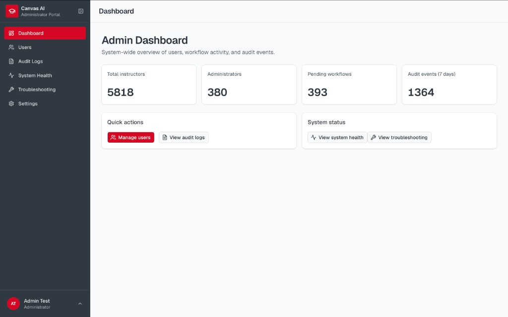
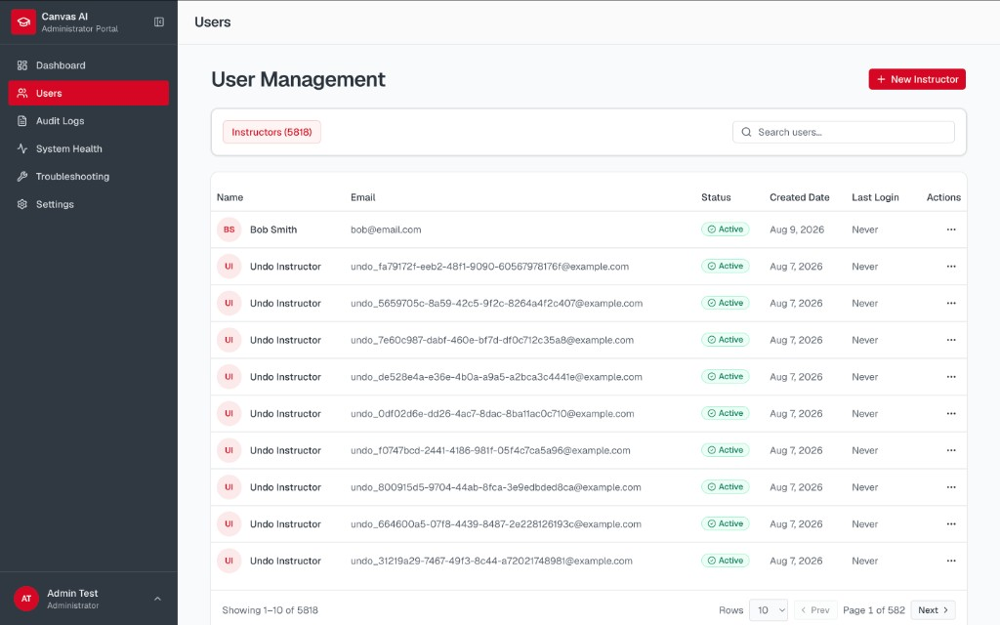
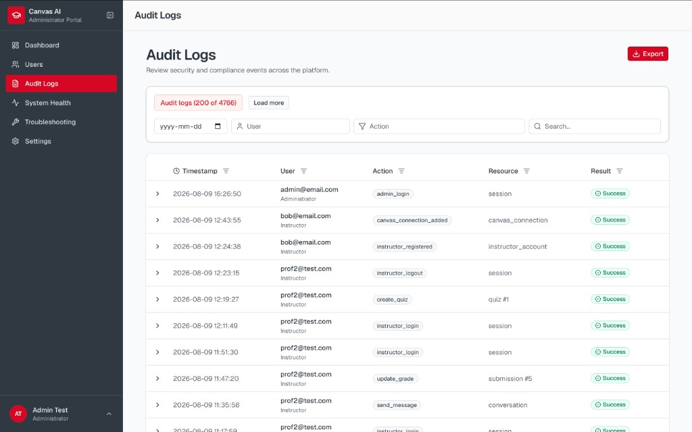
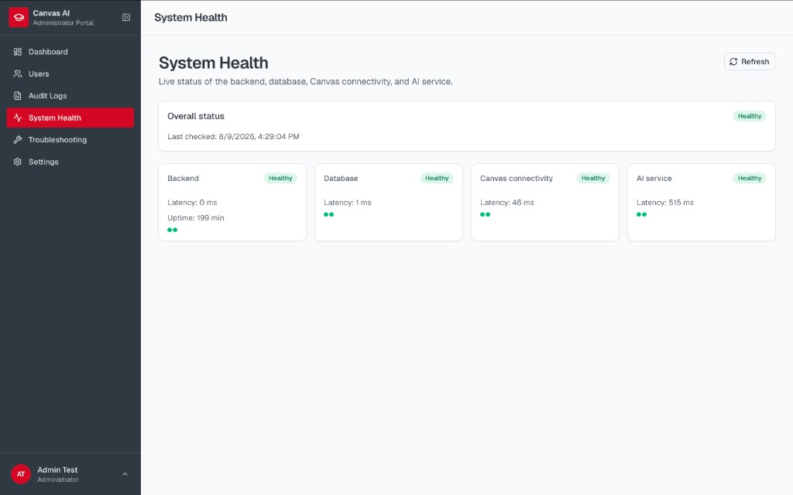
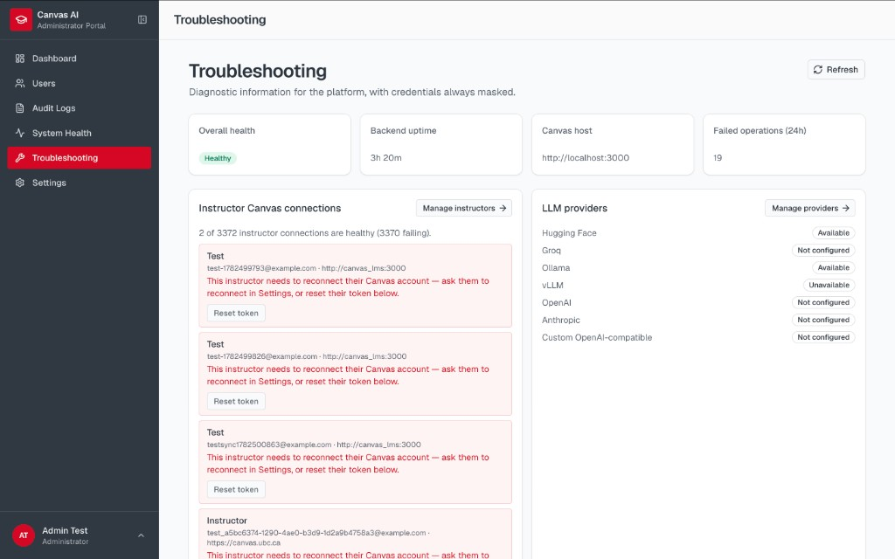
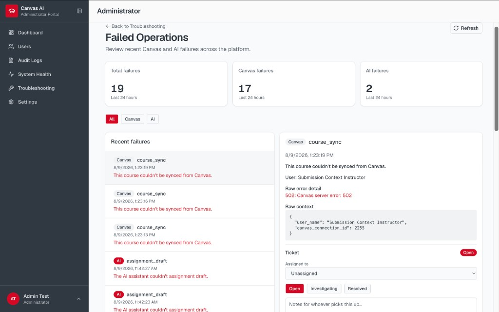

# Administrator User Guide

## 1. Overview

Administrators manage institutions, instructor accounts, Canvas connection health, auditability, and system diagnostics. Admins do **not** perform day-to-day Canvas teaching workflows.

Login uses the admin login path (`/login` with admin credentials / `POST /api/v1/auth/admin/login`).

## 2. Navigation

| Area | Path | Purpose |
| --- | --- | --- |
| Dashboard | `/admin/dashboard` | High-level status |
| Users | `/admin/users` | Instructor management |
| Audit | `/admin/audit` | Audit log browser |
| System health | `/admin/system-health` | DB / Canvas / AI checks |
| Troubleshooting | `/admin/troubleshooting` | Diagnostics & failing connections |
| Failed operations | `/admin/failed-operations` | Failed Canvas/AI ops & tickets |
| Settings | `/admin/settings` | Institution defaults (e.g. LLM) |
| Profile | `/admin/profile` | Account |

## 3. Instructor management

- Create / list instructors.
- Enable or disable accounts.
- View Canvas connections; **revoke** Canvas access when needed.
- Reset Canvas connection state (per product UI) when an instructor is stuck.

## 4. Audit logs

Browse session and workflow-related audit events across users. Use filters to investigate who confirmed what and when.

## 5. System health

Run or view health checks for database, Canvas reachability, and AI/provider status. Historical check entries may be available depending on deployment.

## 6. Troubleshooting & failed operations

- **Troubleshooting:** diagnose failing Canvas connections; deep-link into user lists filtered by connection status.
- **Failed operations:** inspect failures; escalate via **support tickets**. Retry of Canvas writes from this screen is intentionally **not** offered — instructors re-run through normal confirm flows.

## 7. Institution LLM defaults

Configure default provider / failover / cache behaviour for instructors who have not attached personal keys. See also [`../developer/llm-providers.md`](../developer/llm-providers.md).

## 8. Admin safety notes

- Admin tools observe and govern; they do not bypass instructor confirm-before-write for Canvas mutations.
- Prefer revoke + instructor reconnect over sharing tokens.
- Treat audit and failed-ops exports as sensitive (PII may appear in summaries).
