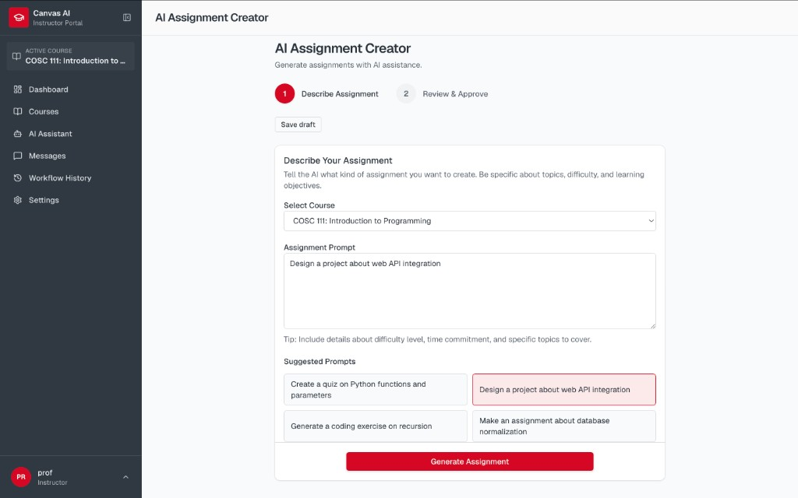
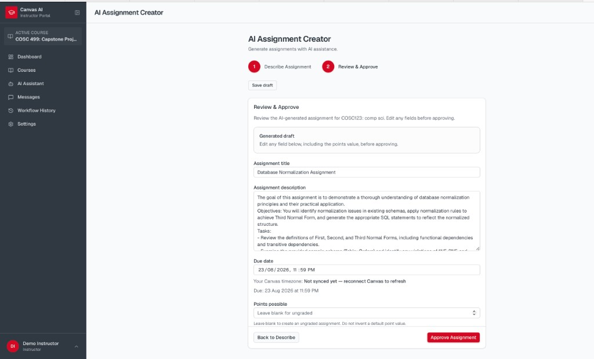

# Assignment Workflow Guide

## Paths

- Form: `/instructor/assignments/create`
- Course assignments: `/instructor/courses/:localCourseId/assignments`
- Assistant: propose `create_assignment` / `update_assignment`

## Create via form

1. Select / confirm the target course (active course for a fresh form; a resumed typed draft uses **its own** saved course when present).
2. **Describe** the assignment (title, description, due date, points or ungraded, publish state, etc.).
3. Generate or edit the draft.
4. **Review / approve** — verify every field.
5. Submit create (preview → confirm pattern). Nothing is written to Canvas until this step succeeds.

### Points vs ungraded

- Enter a **positive** point value for graded work.
- Leave points **blank / null** for an **ungraded** assignment — the app sends Canvas `grading_type=not_graded` and does **not** invent a default (for example `10`).
- In chat, if points were never decided, the assistant asks graded vs ungraded. An explicit “ungraded” answer is remembered for later turns.

### Due dates

Due dates are normalized to **UTC ISO** using the instructor’s Canvas timezone before preview and Canvas write, so the confirmed value matches what Canvas receives.

## Create / update via assistant

1. Describe the assignment in chat (name the course when it is not already in conversation / draft context — do not rely on ambient active course alone).
2. Review the proposal card / dry-run preview.
3. Confirm (or cancel / refine).

Validation surfaces **missing required fields** (ideally all at once) before a valid preview is offered.

## After creation

- Assignment appears in the course list (Canvas is source of truth after sync).
- Creates are typically **undoable** from History when the product exposes undo (deletes exist for undo, not as a general “delete assignment” feature).

## Publish / unpublish & edits

Use course assignment UI or assistant `update_assignment` proposals. Always confirm before Canvas mutation.
