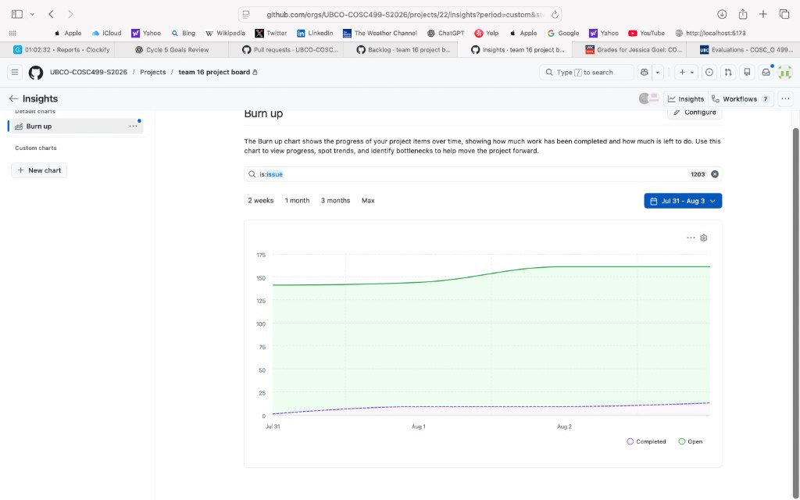
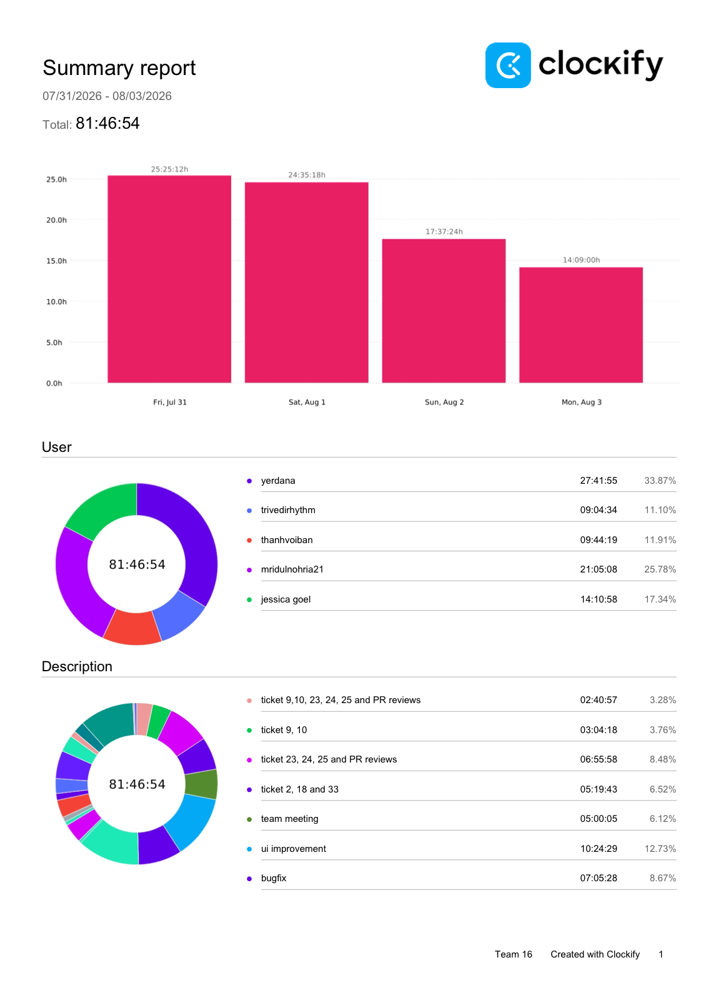

# Cycle 22 (7/31–8/3)

---

# Weekly Team Log

Cycle 22 was a high-velocity post–Testing Event 2 stabilization cycle focused on closing regression tickets, hardening AI assistant trust/grounding behaviour, and preparing the application for Final Demo and final delivery. Rather than adding major new product surfaces, the team concentrated on fixing TE2 findings across Canvas workflows, messaging, quizzes/assignments, authentication/session security, and instructor UX polish.

Hours below come from the official Clockify team summary export for **07/31/2026 – 08/03/2026** (total **81:46:54**). GitHub handles map as: **Mid112 → Mridul**, **StoneCA12 → Bao**.

Collectively the team logged **81 hours, 46 minutes, and 54 seconds**. Development activity produced a large set of merged regression and polish pull requests into `develop`, while a smaller set of high-priority PRs remained open for Final Demo readiness.

---

## Date Range

- **[31-07] – [03-08]**

---

## Features in the Project Plan Cycle

- Final regression / TE2 ticket closure
- AI assistant grounding, loading UX, and missing-submission analysis
- Assignment / quiz create & review polish
- Canvas course context / naming / code validation
- Messaging draft sync and templates
- Auth / session / password-reset hardening
- Documentation, testing reports, and Final Demo preparation
- Individual team logs & time reporting

---

## Project Board Status

Cycle 22 continued the board’s shift from feature delivery into final regression cleanup and demo readiness. Many TE2 tickets moved through review and into Done; remaining open work is concentrated on a short list of polish / delivery PRs.

### Current Project Board Status

| Status | Count / Notes |
| --- | --- |
| Backlog | **107 active items** |
| Ready | **3 active items** |
| In Progress | **21 active items** |
| In Review | **0 on board** (several polish PRs still open on GitHub — see below) |
| Done | **1155 completed items** |

Board snapshot pulled from GitHub Project **team 16 project board** (project #22) while drafting this report.

---

## Completed and Merged Tasks (Cycle 22)

A large batch of TE2 / final-delivery fixes landed on `develop` during and immediately after this cycle window. Highlights:

| PR ID | Description | Status |
| --- | --- | --- |
| #1457 | Fix course creation token error for new accounts | Merged |
| #1458 | Ticket 2: Canvas URL resolution across institution workflows | Merged |
| #1459 | Ticket 33: Per-course Create Assignment on Assignments subtab | Merged |
| #1462 | Review-permissions / troubleshooting UI updates | Merged |
| #1471 | Ticket 18: AI Assistant chat window layout | Merged |
| #1475 | Ticket 9: Refresh course names and code matching | Merged |
| #1476 | Ticket 10: Migration to repair Canvas course names | Merged |
| #1477 | Ticket 8: Persist assignment/student refs across chat turns | Merged |
| #1478 | Ticket 11: Assignment update due-date hour/timezone | Merged |
| #1481 | Ticket 12: Publish / unpublish assignment workflow | Merged |
| #1482 | Ticket 13: Quiz workflow issues from assignment assumptions | Merged |
| #1484 | Ticket 21: Ungraded assignments without forcing points | Merged |
| #1485 | Ticket 22: Improve assignment field validation | Merged |
| #1486 | Ticket 26: Instructor notifications functional | Merged |
| #1493 | Ticket 37: Wire logout to backend session revoke | Merged |
| #1494 | Ticket 38: Stop mock dry-run from faking Canvas execution | Merged |
| #1495 | Ticket 39: Stop dashboard seed metrics fallback | Merged |
| #1496 | Ticket 40: Wire message templates UI to backend | Merged |
| #1497 | PII / grounding: stop destructive scrubbing of instructor-facing replies | Merged |
| #1498 | Real Canvas read behind course submission analysis | Merged |
| #1499 | Ticket 34: Multi-institution course unique constraint | Merged |
| #1500 | Ticket 35: Revoke other sessions after password change | Merged |
| #1501 | Assignment-create chat handoff through draft generator | Merged |
| #1516 | Tickets 24/25: Preserve sent draft snapshot on success | Merged |
| #1517 | Ticket 23: Validate course code format on course creation | Merged |
| #1518 | Architecture / changes.txt documentation | Merged |
| #1519 | Quiz point reconciliation + quiz/assignment routing | Merged |
| #1520 | Resolved assignment/student names in previews & grade handoff | Merged |
| #1522 | Ticket 15: AI loading / thinking feedback | Merged |

Additional effort this cycle also covered PR reviews, Testing Event report refinement, merge-conflict resolution across stacked branches, and Final Demo preparation.

---

## In Progress Tasks / To Do

| Task | Status |
| --- | --- |
| Ticket 14: Quiz question point validation (#1483) | Open / in review |
| Ticket 16: Show all missing required assignment fields at once (#1523) | Open |
| Ticket 19: Missing assignments & analytics in chat (#1474) | Open |
| Ticket 20: Softer assignment-description guardrails (#1524) | Open |
| Ticket 31 + 32: Sidebar + audit log fixes (#1521) | Open |
| Ticket 36: Wire forgot-password flow to backend reset APIs (#1487) | Open |
| Creator workflow audit (#1514) | Open |
| Draft course persist (#1515) | Open |

---

## Upcoming Tasks / Next Cycle

| Feature / Task | Status |
| --- | --- |
| Merge remaining open TE2 / polish PRs | Active |
| Final Demo rehearsal and end-to-end validation | Upcoming |
| Final submission package completeness check | Upcoming |
| User / developer documentation final pass | Active |
| Live Canvas sandbox verification | Upcoming |
| Project board cleanup for final delivery | Upcoming |

---

## Burn-up Chart / Velocity

### Burn-up Summary

The burn-up chart for **Cycle 22 (Jul 31 – Aug 3)** (GitHub Insights, `is:issue`, 1203 items) shows open scope starting near **~140** on Jul 31, rising to about **~160** by Aug 2–3 as new final-delivery / polish tickets were added. Completed work climbed gradually to roughly **~15** issues closed in the charted window. This matches a cycle dominated by PR merges and review iteration rather than a single massive Done-column dump on the issue burn-up.

| Date Range | Trend |
| --- | --- |
| Jul 31 | Open ~140; completed near baseline |
| Aug 1–2 | Open scope rose to ~160 |
| Aug 3 | Open held near ~160; completed ~15 for the cycle window |
| Current Focus | Remaining open PRs, Final Demo, submission package |

---

# Clockify Summary

Time was tracked using Clockify for **Cycle 22 (Jul 31, 2026 – Aug 3, 2026).**

Source: official Clockify **Summary report** export `Clockify_Time_Report_Summary_07_31_2026-08_03_2026.pdf`.

### Team Summary

| Team Member | Clockify Username | GitHub | Logged Time | Share |
| --- | --- | --- | ---: | ---: |
| Yerdana | yerdana | Yerdana2002 | **27:41:55** | 33.87% |
| Mridul | mridulnohria21 | Mid112 | **21:05:08** | 25.78% |
| Jessica | jessica goel | jessica545 | **14:10:58** | 17.34% |
| Bao | thanhvoiban | StoneCA12 | **09:44:19** | 11.91% |
| Rhythm | trivedirhythm | rhythmt1 | **09:04:34** | 11.10% |
| **Total** | | | **81:46:54** | **100%** |

The team logged a combined **81 hours, 46 minutes, and 54 seconds** during Cycle 22. Effort concentrated on TE2 regression fixes, PR reviews, AI grounding/analysis work, messaging/course-context polish, and Final Demo preparation.

---

### Individual Clockify Highlights (from export)

#### Yerdana — **27:41:55**
- ui improvement: 10:24:29
- bugfix 2: 10:11:58
- bugfix: 07:05:28

#### Mridul (Mid112) — **21:05:08**
- ticket 23, 24, 25 and PR reviews: 06:55:58
- ticket 2, 18 and 33: 05:19:43
- team meeting: 03:04:12
- ticket 9, 10: 03:04:18
- ticket 9,10, 23, 24, 25 and PR reviews: 02:40:57

#### Jessica — **14:10:58**
- working on bug fixes and reviewing prs: 08:49:18
- team meeting: 01:55:53
- working on bug fixes: 01:51:53
- working on the testing report: 00:59:23
- creating the summary report: 00:20:00
- reviewing prs: 00:14:31

#### Bao (StoneCA12) — **09:44:19**
- PRs review: 04:36:06
- PRs review + apply 2 fixes: 02:43:00
- meeting: 02:25:13

#### Rhythm — **09:04:34**
- Ticket 19 (#1443): 03:08:57
- Team Meeting: 02:55:46
- PR Reviews: 01:04:31
- Ticket 15 (#1439): 00:51:00
- Ticket 16 (#1440): 00:35:09
- Ticket 20 (#1444): 00:29:11

---

# Test Report / Testing Status

Cycle 22 testing focused on validating TE2 regression fixes and confirming that assistant, Canvas, messaging, quiz/assignment, and auth workflows stayed reliable as many PRs landed in parallel.

Testing activities performed during this cycle included:

- Manual regression verification of TE2 tickets
- AI assistant grounding / unverified-claims UX checks
- Course-wide missing/late submission analysis validation
- Assignment create handoff + description expansion checks
- Quiz points consistency / review UI validation
- Course name/code matching and create-time validation
- Message draft sync / templates verification
- Auth logout / session revoke / password-change session checks
- PR review + CI green confirmation before merges

---

### Frontend Testing

Frontend validation concentrated on instructor-facing flows touched by TE2 tickets: chat/assistant UX, assignment/quiz creators, messaging drafts, notifications, and Canvas connection / course-context behaviour.

Areas reviewed included:

- AI Assistant loading states and clarify prompts
- Assignment create / review / preview flows
- Quiz review question cards and points editing
- Messaging draft / template behaviour
- Dashboard notifications and metrics (no seed fallback)
- Auth logout and password-reset UX paths

---

### Backend Testing

Backend validation focused on services changed by the regression stack: chat analysis chains, grounding/PII separation, Canvas course naming/migrations, assignment audit/workflow claim behaviour, and auth session revocation.

Backend validation included:

- `analyze_course_submissions` published-filter / roster-reuse / history compaction
- Grounding notice-not-redact behaviour for instructor-facing replies
- Assignment create ownership-before-write and claim-commit ordering
- Course unique-constraint / code-format validation
- Session revoke on logout and password change

---

### Testing Outcome

Cycle 22 substantially reduced outstanding TE2 regression risk. Core instructor workflows are more trustworthy (especially AI answers backed by real Canvas reads, and write paths with correct audit/workflow records). Remaining open PRs are polish / final-delivery items rather than broad feature work.

---

# Project Status Summary

## Current State

The project is in final stabilization ahead of the Final Demo and submission. Cycle 22 closed a large share of TE2 regression tickets across Canvas context, messaging, quizzes/assignments, AI grounding/analysis, and auth/session security. The board’s remaining work is a short list of open polish PRs, documentation finalization, and demo rehearsal.

---

# Feature Ownership Overview

| Feature / Area | Primary Owner |
| --- | --- |
| Documentation, reporting, TE2 ticket merges / reviews | Jessica |
| AI grounding, submission analysis, quiz/assignment create audit | Yerdana |
| Canvas URL / course naming / messaging draft sync / docs package | Mridul (Mid112) |
| AI loading UX, missing-fields clarify, guardrails, chat analytics | Rhythm |
| Sidebar / audit / troubleshooting UI polish | Bao (StoneCA12) |

---

# Main Risks / Remaining Gaps

| Risk / Gap | Impact | Next Step |
| --- | --- | --- |
| Open polish PRs (#1483, #1487, #1474, #1514, #1515, #1521, #1523, #1524) | Could delay Final Demo readiness | Finish review/merge before demo |
| Live Canvas sandbox e2e verification | Real-environment gaps may remain | Complete sandbox verification |
| Final documentation / submission package completeness | Delivery risk | Final docs + package review |

Overall project risk remains **low to moderate**, with remaining work focused on polish, verification, and delivery packaging.

---

# Individual Team Contributions

### Jessica

Focused on TE2 regression tickets (course create token, assignment/quiz/message/auth/session fixes), teammate PR reviews, Testing Event report refinement, and coordinating merges into `develop`. Also maintained personal/team logging for the cycle.

### Mridul

Closed Canvas URL, chat-window, course-name/code, messaging draft sync, and course-code validation tickets; continued final documentation / submission-package work; and reviewed teammate PRs for delivery readiness.

### Yerdana

Led AI trust fixes (PII vs grounding separation, course submission analysis with real Canvas reads), assignment-create generator handoff / audit holes, quiz point reconciliation, stacked-branch conflict resolution, and deep review responses with failing-test-first habit.

### Rhythm

Delivered AI loading/thinking feedback (merged), plus open work on missing-assignment analytics in chat, single-turn missing-field clarification, and softer assignment-description guardrails; also reviewed early TE2 PRs and aligned bug priorities in the Friday meeting.

### Bao (StoneCA12)

Logged **09:44:19** on Clockify (meeting, PR reviews, and applying review fixes). Open delivery work includes sidebar / audit-log polish (#1521).

---

# Cycle Achievements

- Large TE2 regression batch merged into `develop`
- AI assistant answers no longer invent course-wide submission stats without a real Canvas read
- Instructor-facing replies stopped being destructively scrubbed for grades/titles
- Assignment/quiz create & review paths hardened (points, handoff expansion, audit/workflow)
- Course context / naming / code validation improved for create and matching flows
- Messaging draft sync + templates wired more correctly
- Auth/session security gaps closed (logout revoke, password-change session revoke)
- Official Clockify team total recorded: **81:46:54** (all five members)
- Personal Cycle 22 logs merged for Jessica, Mridul, Rhythm, and Yerdana

---

# Lessons Learned

- Stacked regression PRs need a deliberate merge order; resolving conflicts only after upstream lands avoids repeated churn
- Review feedback is most reliable when reproduced with a failing test before coding
- AI product fixes must separate inbound privacy controls from outbound trust/grounding UX
- Course-context bugs cascade across create, resume, messaging, and analytics — shared resolution helpers pay off
- Official Clockify exports should be preferred over hand-summed personal-log hours when totals disagree

---

# Objectives for Cycle 23 / Final Delivery

- Merge remaining open polish PRs
- Complete Final Demo rehearsal and end-to-end validation
- Finish user/developer documentation and submission package checks
- Keep board counts current through Final Demo
- Live Canvas sandbox verification
- Final repository / project-board cleanup
- Submit final deliverables

---

# Team Outlook

Cycle 22 moved the project from “many TE2 tickets open” to “mostly merged, short open list.” The application is substantially more stable for Final Demo. With remaining polish PRs closed and documentation/demo prep finished, the team is positioned to complete final delivery on schedule. Cycle 22’s **81:46:54** Clockify total reflects sustained finalization effort across all five members.
