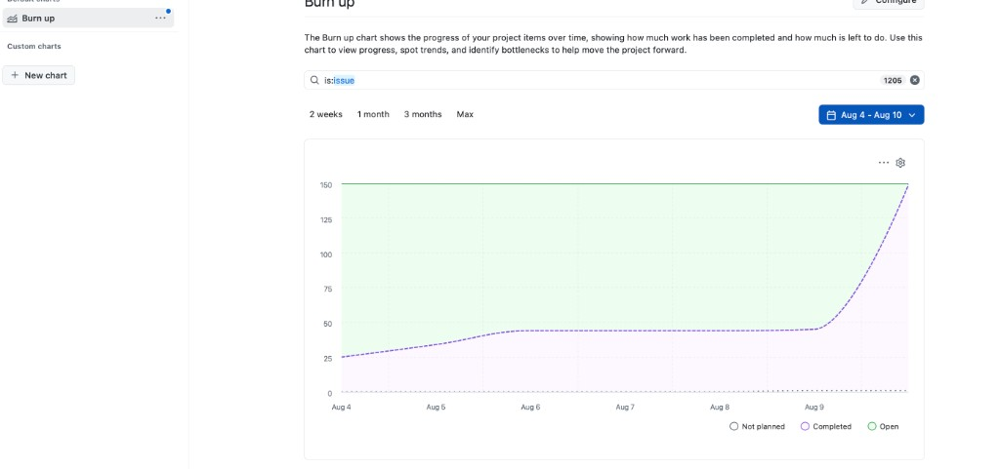
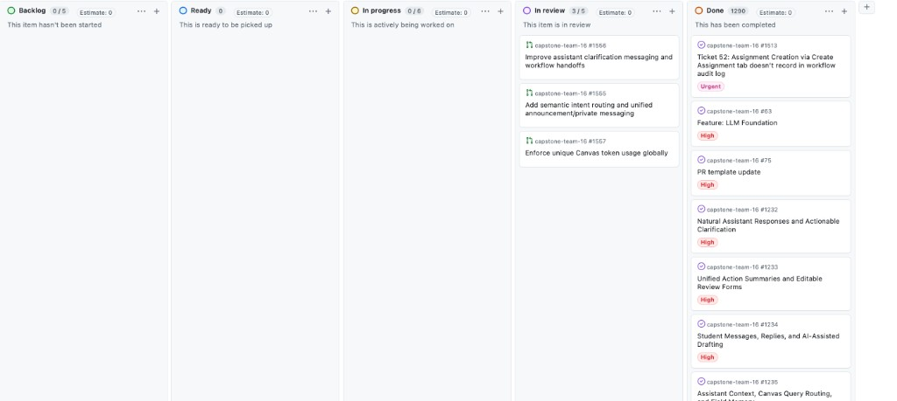
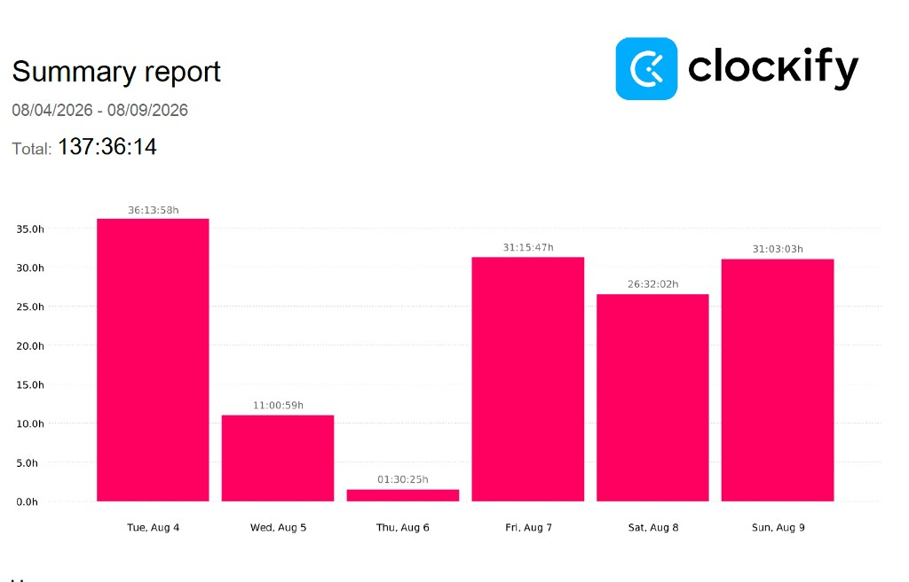
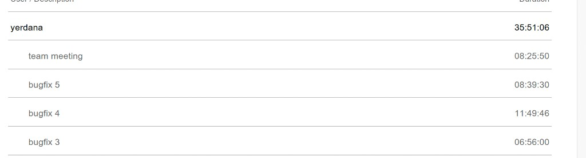
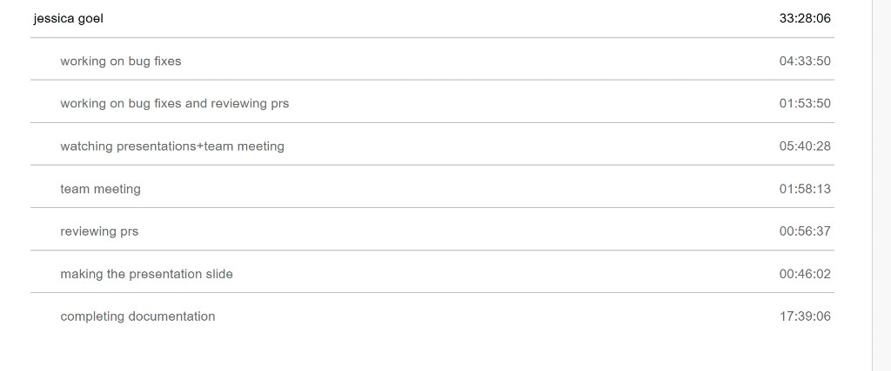
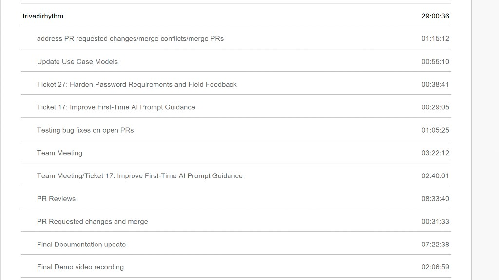
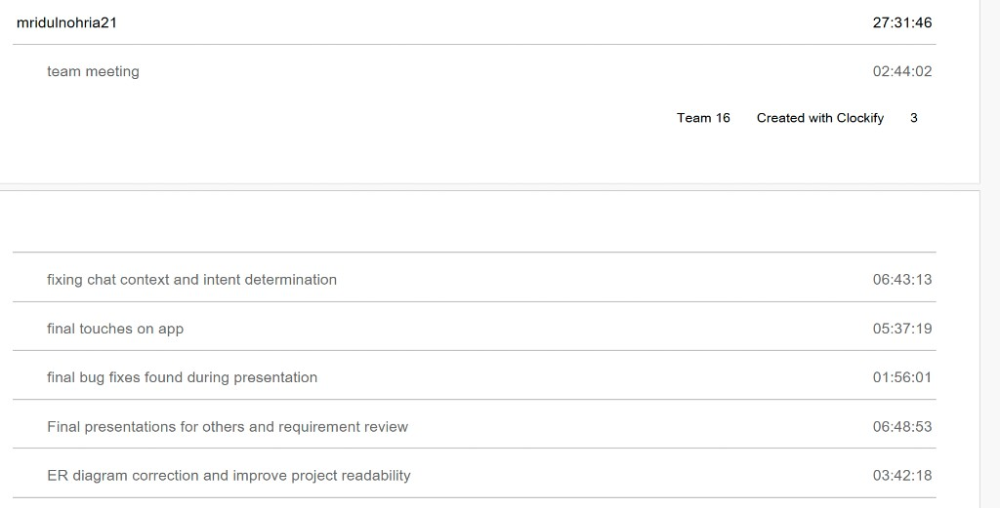
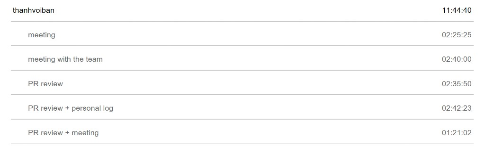

# Cycle 23 (8/4–8/9)

---

## Burn-up Chart (Velocity)

### Burn-up Summary

The burn-up chart for **Cycle 23 (Aug 4 – Aug 10)** (`is:issue`) shows **open** scope flat at about **~150**. **Completed** rose from **~25** to **~45** by **Aug 6**, stayed flat through **Aug 9**, then rose sharply to about **~150** by **Aug 10**, closing the gap to open scope as final tickets landed.

| Date Range | Trend |
|------------|-------|
| Aug 4–6 | Completed ~25 → ~45; open flat at ~150 |
| Aug 7–9 | Completed held near ~45; open still ~150 |
| Aug 10 | Completed surged to ~150, meeting open scope |
| Current Focus | Ordered merge of remaining open PRs + final submission package |

---

## Project Board Summary

The project board is in final delivery mode. Most TE2 regression and polish tickets moved to Done during this cycle; leftovers are concentrated in a small set of large open PRs and documentation tasks.

### Current Final Delivery Board Status

| Status | Count / Notes |
| --- | --- |
| Backlog | **0** |
| Ready | **0** |
| In Progress | **0** |
| In Review | **3** (#1556, #1555, #1557) |
| Done | **1290** |

Counts from GitHub Project **team 16 project board**.

---

## Closed / Completed Tasks

Major completed themes this cycle:

- Quiz / assignment draft resume, points, due-date, and prompt-preservation fixes
- Messaging tab / announcements / compose placement improvements
- AI page clutter reduction and first-time prompt guidance
- Course-context precedence and missing-submission analysis fixes
- Password policy + forgot-password / session revoke hardening
- Design-doc updates (ER, DFD, use cases)
- Deep review of remaining assistant / token / reversibility PRs
- Final Demo preparation and personal Cycle 23 logs (Mridul, Bao, Yerdana, Rhythm, Jessica Clockify attached)
- Team + individual Clockify screenshots and board/burn-up attachments

---

## Upcoming Tasks / Next Cycle

Post-log product hand-over (open on GitHub; team log deliverable complete):

| Feature / Task | Status |
| --- | --- |
| Merge #1557 → #1556 → #1555; split/rebase #1558 | Active |
| Final documentation package (#1533) | Active |
| Final Design Report / submission package finalize | Active |
| Publish demo artifacts / release tag | Planned |

---

## Clockify Summary

Time was tracked using Clockify for **Cycle 23 (Aug 4, 2026 – Aug 9, 2026).**

### Team Summary

| Team Member | Clockify Username | GitHub | Logged Time |
| --- | --- | --- | ---: |
| Yerdana | yerdana | Yerdana2002 | **35:51:06** |
| Jessica | jessica goel | jessica545 | **33:28:06** |
| Rhythm | trivedirhythm | rhythmt1 | **29:00:36** |
| Mridul | mridulnohria21 | Mid112 | **27:31:46** |
| Bao | thanhvoiban | StoneCA12 | **11:44:40** |
| **Total** | | | **137:36:14** |

The team logged a combined **137 hours, 36 minutes, and 14 seconds** during Cycle 23.

### Daily Team Hours

| Day | Hours |
| --- | ---: |
| Tue Aug 4 | **36:13:58** |
| Wed Aug 5 | **11:00:59** |
| Thu Aug 6 | **01:30:25** |
| Fri Aug 7 | **31:15:47** |
| Sat Aug 8 | **26:32:02** |
| Sun Aug 9 | **31:03:03** |

### Team Clockify

### Individual Clockify Reports

#### Yerdana — **35:51:06**

- team meeting — 08:25:50
- bugfix 5 — 08:39:30
- bugfix 4 — 11:49:46
- bugfix 3 — 06:56:00

#### Jessica — **33:28:06**

- completing documentation — 17:39:06
- watching presentations + team meeting — 05:40:28
- working on bug fixes — 04:33:50
- team meeting — 01:58:13
- working on bug fixes and reviewing PRs — 01:53:50
- reviewing PRs — 00:56:37
- making the presentation slide — 00:46:02

#### Rhythm — **29:00:36**

- PR Reviews — 08:33:40
- Final Documentation update — 07:22:38
- Team Meeting — 03:22:12
- Team Meeting / Ticket 17: Improve First-Time AI Prompt Guidance — 02:40:01
- Final Demo video recording — 02:06:59
- address PR requested changes / merge conflicts / merge PRs — 01:15:12
- Testing bug fixes on open PRs — 01:05:25
- Update Use Case Models — 00:55:10
- Ticket 27: Harden Password Requirements and Field Feedback — 00:38:41
- PR Requested changes and merge — 00:31:33
- Ticket 17: Improve First-Time AI Prompt Guidance — 00:29:05

#### Mridul — **27:31:46**

- Final presentations for others and requirement review — 06:48:53
- fixing chat context and intent determination — 06:43:13
- final touches on app — 05:37:19
- ER diagram correction and improve project readability — 03:42:18
- team meeting — 02:44:02
- final bug fixes found during presentation — 01:56:01

#### Bao — **11:44:40**

- PR review + personal log — 02:42:23
- meeting with the team — 02:40:00
- PR review — 02:35:50
- meeting — 02:25:25
- PR review + meeting — 01:21:02

---

## Project Status Summary

### Current State

Final delivery cycle complete for planning purposes. Application functionality is demo-ready; remaining product work is controlled merging of reviewed leftover PRs and finishing submission documentation. Cycle 23 team log (hours, screenshots, wrap-ups) is complete.

---

## In Progress / To Do

Open on GitHub at cycle end (team log wrap-up complete):

| Item | Status |
| --- | --- |
| #1555 Intent routing + messaging delivery | Open |
| #1556 Clarification / handoff UX | Open (rebase onto #1555) |
| #1557 Unique Canvas tokens | Open (approved after follow-ups) |
| #1558 Reversibility / multi-theme branch | Open (split/rebase) |
| #1533 Final documentation package | Draft |

**Log close-out:** Jessica Clockify attached; screenshots attached; Achievements / Lessons / Outlook mirrored below.

---

## Test Report / Testing Status

- Manual verification of merged polish tickets
- Adversarial PR review of #1555–#1558
- Password-policy and due-date regression suites
- Final Demo end-to-end rehearsal

---

## Feature Ownership Overview

| Feature / Area | Primary Owner(s) |
| --- | --- |
| Final ticket closure | Jessica, Rhythm, Yerdana, Mridul |
| Chat intent / course context | Mridul, Yerdana |
| Auth hardening | Rhythm, Jessica |
| Shared resolvers / badges / quick actions | Yerdana |
| Token uniqueness | Mridul |
| Docs / demo / reviews | Rhythm, Jessica, Bao, Mridul |

---

## Main Risks / Remaining Gaps

Product risks remain on GitHub. **Cycle 23 team logging is complete** (Clockify **137:36:14**, Jessica hours + screenshots attached, wrap-ups done).

| Risk / Gap | Impact | Next Step |
| --- | --- | --- |
| Overlapping assistant PRs | Regression risk on merge | Follow merge order; split #1558 |
| Docs package incomplete | Submission gap | Finish #1533 |

---

## Cycle Achievements

- Final delivery board: **Done 1290**, **In Review 3**
- TE2 / polish merges + docs/demo prep; reviews of #1555–#1558
- Clockify **137:36:14** with Jessica hours and screenshots attached; log wrap-up complete

---

## Lessons Learned

- Keep an explicit merge order for stacked final PRs; pair token uniqueness with test isolation
- Demo rehearsal still surfaces late bugs; shared resolvers reduce cross-ticket churn

---

## Team Outlook

Demo-ready product with a short reviewed open-PR list. Finish ordered merges and #1533 for submission. Team log for Cycle 23 is complete (**137:36:14**).

---

## Overall Summary

Cycle 23 was the final delivery cycle. The team logged **137:36:14**, closed most remaining polish work (board Done **1290**), and completed documentation/demo prep plus deep review of leftover assistant/token/reversibility PRs. Remaining open GitHub work is hand-over only; this team log is finished.
